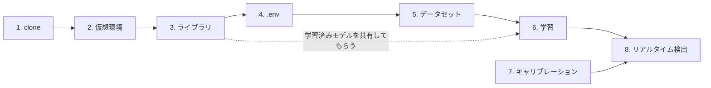

# atom-badminton-ai

チャレンジアトム向け「伴走型Physical AI」バドミントンシャトル発射機プロジェクトの一部として、
カメラ映像からシャトルコックを検出し、実空間上の3次元位置 (X, Y, Z) を推定する仕組みを開発しています。
YOLOによる物体検出とカメラキャリブレーションを組み合わせ、Webカメラだけでシャトルの飛来位置を
リアルタイムに推定することを目指しています。

## リポジトリの管理方針

このリポジトリでは、以下の2つの方針でコミット対象を絞っています(詳細は `.gitignore` 参照)。

1. **再現可能なものはコミットしない**
   仮想環境、学習済みモデルの重み、ダウンロード可能なデータセットなどは、スクリプトを
   再実行すれば手元で再構築できるため、リポジトリには含めていません。
2. **秘密情報・個人情報はコミットしない**
   APIキーや、撮影した本人が写り込む可能性のある画像・動画などは、プライバシー・
   セキュリティ上の理由でリポジトリには含めていません。

## ディレクトリ構成

### スクリプト

| ファイル | 説明 |
|---|---|
| `calibrate_camera.py` | `images/calibration/` 内のチェッカーボード画像(内部コーナー9x6、1マス25mm)からカメラキャリブレーションを行い、カメラ行列(fx, fy, cx, cy)・歪み係数・再投影誤差を算出して `camera_calibration.yaml` に保存する |
| `train_yolo.py` | 事前学習済みの `yolov8n.pt` を読み込み、`datasets/merged/data.yaml` を使ってシャトルコック検出モデルを転移学習する(GPU使用、`--epochs`で指定可能・デフォルト50)。結果は `runs/<--nameで指定した名前>/`(デフォルト `shuttlecock_v2`)に保存される |
| `predict_yolo.py` | 学習済みモデル(`runs/shuttlecock_v2/weights/best.pt`)で `datasets/merged/test/images` に対して推論し、検出結果画像を `runs/predict_test/` に保存する |
| `realtime_detect.py` | `camera_calibration.yaml` の値と学習済みモデルを使い、Webカメラ映像からシャトルコックをリアルタイム検出して距離(X, Y, Z)を推定・表示する。さらに `trajectory_predictor.py` で数百ミリ秒先の軌道(`--floor-y-cm` 指定時は落下地点も)をリアルタイム予測し、映像に重ねて表示する。軌道は `trajectories/` に、予測結果は `trajectories/predictions/` にCSVとして保存される |
| `trajectory_predictor.py` | リアルタイム軌道予測ロジック。直近0.5秒の検出点に等加速度運動モデルをフィットし直して未来の位置・落下時刻を予測する(`realtime_detect.py` から利用)。単体で実行すると `trajectories/` の記録済みCSVを再生して予測精度(静止仮定との比較)を評価する |
| `visualize_trajectory.py` | `trajectories/` 内の軌道CSVを読み込み、3D軌跡・時系列グラフ(X/Y/Z、見かけサイズ、confidence)を生成して `trajectories/plots/` に保存する。異常値(低confidence、大きな座標ジャンプ)の統計もターミナルに表示する |
| `smooth_and_predict.py` | `trajectories/` 内の軌道CSVに対し、低confidence行・座標ジャンプ行を除外したうえで平滑化(移動平均 または Savitzky-Golay、`--method`で切替)し、放物運動(等加速度運動)モデルをX/Y/Zにフィットする。フィッティング結果(初期位置・初速度・加速度)とRMSEをターミナルに表示し、生データ・平滑化後・フィット曲線を重ねた3Dグラフを `trajectories/plots/` に、平滑化後データを `<元ファイル名>_smoothed.csv` として保存する |
| `realtime_pose_detect.py` | MediaPipe Pose Landmarkerを使い、Webカメラ映像から人物の骨格を検出、左右足首の中点を「立ち位置」とみなす。カメラの設置高さ・俯角を仮定した簡易床面投影でX(左右)・Z(奥行き)を概算する(既知サイズが無いため厳密なZ算出はできず、MVP的な近似実装。詳細はスクリプト冒頭のコメント参照)。実行結果は `person_positions/` にCSVとして保存される。立ち位置は `launch_control/` の発射判断にも渡される(`--no-launch-control` で無効化) |
| `launch_control/` | シャトル発射機の「判断と行動」部分(ダミー版、標準ライブラリ中心)。`config.py`(設定値・仰角→距離の対応表)、`aiming.py`(座標変換・パン/チルト角の計算)、`launcher.py`(ハードウェアの抽象化、`MockLauncher` / 未実装の `AK45Launcher`)、`fire_controller.py`(発射判断の状態機械と `shots.csv` への記録)、`overlay.py`(映像への状態表示)、`demo_sim.py`(カメラなしのシミュレーション)。詳細は下記「11. 発射機の判断(ダミー版)」 |
| `tests/` | 単体テスト(`python -m unittest discover -s tests`) |
| `download_datasets.py` | `.env` の `ROBOFLOW_API_KEY` を使い、Roboflow上のシャトルコック検出用データセット2種(`datasets/adwproj/`, `datasets/pradyumna/`)と自前撮影・アノテーション済みデータセット(`datasets/experiment/`)をダウンロードし、続けて `datasets/merged/` に統合する(train/valid/testごとにimages・labelsをコピーし、ファイル名の重複がないか確認、`data.yaml` を生成) |

### 設定・データファイル

| ファイル | 説明 |
|---|---|
| `camera_calibration.yaml` | `calibrate_camera.py` の出力。カメラ行列(fx, fy, cx, cy)、歪み係数、校正時の画像解像度などを含む。`realtime_detect.py` がこれを読み込んで距離推定に使う |
| `requirements.txt` | pipの依存パッケージ一覧(`pip freeze` 形式)。学習・推論に必要な主要パッケージ(torch, ultralytics, opencv-python など)に加え、`download_datasets.py` が使う `python-dotenv` と `roboflow`、およびそれらの依存パッケージも含む |
| `.env` | `ROBOFLOW_API_KEY` を保持する秘密情報ファイル。Git管理外のため、各自作成が必要 |
| `.gitignore` | Git管理から除外するファイル・フォルダのルール |

### .gitignore で除外されているフォルダ

| フォルダ | 内容 |
|---|---|
| `venv/`, `venv_win/` | Python仮想環境(それぞれLinux/WSL用、Windows用)。`requirements.txt` から再構築できるため管理しない |
| `datasets/` | `download_datasets.py` でダウンロードした学習用データセット(`adwproj/`, `pradyumna/`)、自前撮影・アノテーション済みデータセット(`experiment/`)、それらを統合した `merged/`。容量が大きく、再取得可能なため管理しない |
| `runs/` | `train_yolo.py` の学習結果(重み `weights/best.pt`、学習ログ `results.csv` など)や `predict_yolo.py` の推論結果画像。再実行すれば生成できるため管理しない |
| `images/` | カメラキャリブレーション用に撮影した画像(`images/calibration/`)。撮影者が写り込む可能性があるため管理しない |
| `trajectories/` | `realtime_detect.py` の実行結果(軌道CSV、予測CSV `trajectories/predictions/`)と `visualize_trajectory.py` / `smooth_and_predict.py` が生成するグラフ・平滑化後CSV(`trajectories/plots/`, `*_smoothed.csv`)。実行のたびに増える計測データのため管理しない |
| `person_positions/` | `realtime_pose_detect.py` の実行結果(立ち位置ログCSV)。人物の動きが記録されるためプライバシー配慮も兼ねて管理しない |
| `shots/` | 発射ごとの記録 `shots.csv`。人の立ち位置を含むため、`person_positions/` と同じ理由で管理しない |
| `weights/` | `*.pt` にマッチするため除外対象。学習済みYOLOモデルに加え、`realtime_pose_detect.py` が初回実行時に自動ダウンロードするMediaPipeのPose Landmarkerモデル(`*.task`)もここに保存され、同様に除外される |
| `__pycache__/` | Pythonの実行キャッシュ |

## 新しい環境でのセットアップ手順

### 0. はじめに

#### やりたいこと別の進め方

全部の手順を最初から順にやる必要はありません。目的に合わせて必要な手順だけ進めてください。
新しいPCで始める場合は、先に [準備](#準備-開発環境wsl2--ubuntuの用意) でWSL2 + Ubuntuを
用意してください。

| やりたいこと | 必要な手順 | 実行環境 | 目安時間 |
|---|---|---|---|
| 🧪 カメラなしで発射判断・軌道予測ロジックを試す | 1 → 2 → 3 → [動作確認](#動作確認カメラなし) | WSL / Windows | 約15分 |
| 🎥 学習済みモデルでリアルタイム検出を試す | 1 → 2 → 3 → 6(`best.pt` を共有してもらう)→ 8 | Windows | 約30分 |
| 🏋️ データセット取得からモデルを学習し直す | 1 → 2 → 3 → 4 → 5 → 6 | WSL(GPU) | 数時間 |
| 📷 別のカメラに替える | 7 → 8 | Windows | 約30分 |

#### 全体の流れ



#### 必要なもの

| 項目 | 内容 | 必要な手順 |
|---|---|---|
| OS | Windows 11 + WSL2(Ubuntu 24.04 LTS) | すべて |
| Python | WSL側は 3.12、Windows側は 3.13 で動作確認済み | すべて |
| NVIDIA GPU + ドライバ | Windows側にドライバを入れる。CUDA 12.4 対応版の PyTorch を使用。GPUがなければ学習は省略して `best.pt` を共有してもらう | 6 |
| Roboflow アカウント | APIキーの発行に必要 | 4, 5 |
| Webカメラ | Windows側から認識できるUSBカメラ | 7, 8, 10 |
| チェッカーボード | 内部コーナー9x6、1マス25mm(印刷したものでOK) | 7 |

> [!IMPORTANT]
> **開発はWSL、カメラを使う実行はWindows** という役割分担です。WSLはUSBカメラに
> 直接アクセスできないため、手順 7・8・10 はWindows側(`venv_win`)で実行してください。
> 両方使う場合は、手順2・3を WSL と Windows それぞれで行います。

---

### 準備. 開発環境(WSL2 + Ubuntu)の用意

開発は **Windows 11 上の WSL2 + Ubuntu 24.04 LTS** を前提にしています。すでにUbuntuが
動いていて `nvidia-smi` でGPUが見える場合は、[P-3](#p-3-ubuntuに必要なパッケージを入れる)
から確認してください。

#### P-1. WSL2 と Ubuntu 24.04 のインストール(Windows側)

**管理者として開いたPowerShell** で実行します。

```powershell
wsl --install -d Ubuntu-24.04
```

完了したらPCを再起動します。再起動後にUbuntuのウィンドウが開くので、Linux用の
ユーザー名とパスワードを設定してください(Windowsのアカウントとは別物です。
`sudo` のときに使います)。

✅ **確認**(PowerShell):`VERSION` が `2` になっていればOKです。

```powershell
wsl -l -v
```

<details>
<summary>⚠️ VERSION が 1 になっている場合</summary>

```powershell
wsl --set-version Ubuntu-24.04 2
```

「仮想マシンプラットフォーム」が無効だと言われた場合は、BIOS/UEFIで仮想化
(Intel VT-x / AMD-V)が有効になっているか確認してください。

</details>

#### P-2. NVIDIA ドライバ(Windows側だけに入れる)

学習(手順6)でGPUを使う場合に必要です。

- NVIDIA公式サイトから、GPUに合った **Windows用** のドライバ(Game Ready / Studio)を
  インストールする。WSL2からはWindows側のドライバがそのまま使われる
- **Ubuntu側にLinux用のNVIDIAドライバを入れないでください。** WSLのGPU連携が壊れます
- CUDA Toolkit のインストールは不要です。PyTorchのパッケージにCUDAの実行に必要な
  ライブラリが含まれています

✅ **確認**(Ubuntu):GPU名とドライバのバージョンが表示されればOKです。

```bash
nvidia-smi
```

(参考:開発機は GeForce RTX 3050 6GB Laptop GPU、ドライバ 581.86 で動作確認済み)

#### P-3. Ubuntuに必要なパッケージを入れる

ここから先はUbuntuのターミナルで実行します。

```bash
sudo apt update && sudo apt upgrade -y
sudo apt install -y python3.12-venv python3-pip git libgl1 libglib2.0-0t64
```

| パッケージ | 用途 |
|---|---|
| `python3.12-venv`, `python3-pip` | 仮想環境の作成とpip(Ubuntu 24.04 はPython 3.12が標準で入っている) |
| `git` | リポジトリのclone |
| `libgl1`, `libglib2.0-0t64` | OpenCV(`cv2`)のimportに必要なライブラリ |

✅ **確認**:

```bash
python3 --version   # Python 3.12.x
git --version
```

#### P-4. Gitの初期設定

```bash
git config --global user.name "あなたの名前"
git config --global user.email "あなたのメールアドレス"
```

pushする場合はGitHubの認証も必要です。GitHub CLI(`sudo apt install -y gh`)を入れて
`gh auth login` を実行するのが簡単です。

#### P-5. Windows側のPython(カメラを使う場合)

手順7・8・10 はWindows側で実行するため、WindowsにもPythonが必要です。PowerShellで
インストールします(python.org のインストーラーを使う場合は「Add python.exe to PATH」に
チェックを入れてください)。

```powershell
winget install -e --id Python.Python.3.13
```

✅ **確認**(新しく開いたPowerShell):

```powershell
python --version   # Python 3.13.x
```

---

### 1. リポジトリをclone

Ubuntuのターミナルで、**ホームディレクトリ(`~`)の下に** cloneします。

```bash
cd ~
git clone https://github.com/RK200781/atom-badminton-ai.git
cd atom-badminton-ai
```

> [!TIP]
> `/mnt/c/...`(Windows側のフォルダ)の下にcloneすると、ファイルの読み書きが非常に
> 遅くなり、学習やデータセットの統合に時間がかかります。Ubuntu側に置いてください。
> Windows側からは、エクスプローラーやPowerShellで
> `\\wsl.localhost\Ubuntu-24.04\home\<Linuxのユーザー名>\atom-badminton-ai`
> として同じフォルダを開けます(手順2の `venv_win` もこのフォルダに作ります)。

### 2. Python仮想環境の作成・有効化

**WSL / Linux の場合:**

```bash
python3 -m venv venv
source venv/bin/activate
```

**Windows (PowerShell) の場合:**

```powershell
python -m venv venv_win
venv_win\Scripts\Activate.ps1
```

✅ **確認**:プロンプトの先頭に `(venv)` / `(venv_win)` と表示されればOKです。

<details>
<summary>⚠️ Windowsで「スクリプトの実行が無効になっている」と言われる場合</summary>

PowerShellの実行ポリシーで `Activate.ps1` がブロックされています。そのウィンドウの間だけ
許可してから、もう一度有効化してください。

```powershell
Set-ExecutionPolicy -Scope Process -ExecutionPolicy RemoteSigned
venv_win\Scripts\Activate.ps1
```

</details>

### 3. ライブラリのインストール

`requirements.txt` の PyTorch は CUDA 12.4 版(`torch==2.6.0+cu124`)で、通常の PyPI には
置かれていません。PyTorch の配布元を追加してインストールします。

```bash
pip install -r requirements.txt --extra-index-url https://download.pytorch.org/whl/cu124
```

✅ **確認**:主要パッケージが読み込めて、GPUが認識されているか確認します。

```bash
python -c "import torch, ultralytics, cv2, mediapipe; print('torch', torch.__version__, '/ CUDA:', torch.cuda.is_available())"
```

`CUDA: True` なら学習にGPUを使えます。`False` でも検出・判断ロジックの実行は可能です
(学習だけは時間がかかりすぎるため、GPU環境で行うか `best.pt` を共有してもらってください)。

> [!NOTE]
> `roboflow` の依存関係により `opencv-python-headless` も入り、`numpy` は 2.3.5 に
> 固定されます。パッケージを個別に更新すると衝突しやすいので注意してください
> (「既知の注意点」参照)。

### 4. `.env` ファイルの作成

> 手順5(データセットの取得)をしない場合は不要です。

Roboflowにログインし、[Settings → API Keys](https://app.roboflow.com/settings/api) から
APIキーを確認します。リポジトリ直下に `.env` ファイルを作成し、APIキーを設定してください
(このファイルはGit管理外なので、各自で作成する必要があります)。

```
ROBOFLOW_API_KEY=あなたのAPIキー
```

> [!CAUTION]
> APIキーは秘密情報です。`.env` をコミットしたり、チャットなどに貼り付けたりしないでください。

### 5. データセットの取得

`.env` にAPIキーを書いたら、WSL側で以下を実行するだけです。

```bash
python download_datasets.py
```

次の3つのデータセットがダウンロードされ、続けて `datasets/merged/`(`train_yolo.py` /
`predict_yolo.py` が参照する統合データセット)が自動的に作成されます。

| 保存先 | データセット | 枚数(train / valid / test) |
|---|---|---|
| `datasets/adwproj/` | 公開データセット(Roboflow Universe) | 647 / 178 / 86 |
| `datasets/pradyumna/` | 公開データセット(Roboflow Universe) | 392 / 20 / 10 |
| `datasets/experiment/` | 自前撮影・アノテーション済み(Roboflowプロジェクト `-kz8ad/atom-badminton-ai` v1) | 234 / 67 / 33 |
| **`datasets/merged/`** | **上の3つを統合したもの** | **1273 / 265 / 129** |

統合処理はスクリプト内で以下を行います。

- train/valid/testそれぞれについて、3つのデータセットのimages・labelsを
  `datasets/merged/<split>/images`, `labels` にコピー
- コピー時にファイル名の重複がないか確認し、重複があれば警告してスキップ
- `datasets/merged/data.yaml`(`nc: 1`, `names: ['shuttlecock']`)を生成

再実行するたびに `datasets/merged/` は作り直されるため、常にダウンロード済みの
最新データセットの内容と一致します。何度実行しても問題ありません。

✅ **確認**:ターミナルに `自前撮影データセットを検出しました` と表示され、最後の統合結果が
上の表の `datasets/merged/` の枚数と一致すればOKです。

<details>
<summary>⚠️ 「自前撮影データセットをダウンロードできませんでした」と表示される場合</summary>

`.env` のAPIキーのアカウントが、自前撮影データセットのプロジェクトにアクセスできていません。
このとき統合は公開データセット2種だけで続行されるため、`shuttlecock_v2` と同じモデルは
再現できません。プロジェクトのあるRoboflowワークスペースに招待してもらい、そのワークスペースの
APIキーを `.env` に設定してから、もう一度実行してください。

</details>

### 6. モデルの学習(または学習済みモデルの共有)

#### A. 自分で学習する(GPU環境がある場合)

```bash
python train_yolo.py --name shuttlecock_v2
```

| オプション | デフォルト | 説明 |
|---|---|---|
| `--name` | `shuttlecock_v2` | 保存先 `runs/<name>/`。既存の学習結果を上書きしないよう、再学習のたびに別名を指定すること |
| `--epochs` | 50 | 学習エポック数 |

学習結果は `runs/<name>/weights/best.pt` に保存されます。**現在は
`runs/shuttlecock_v2/weights/best.pt` を主軸として使用しています**(adwproj + pradyumna +
自前撮影データで学習、旧 `shuttlecock_baseline` よりPrecision/Recall/mAP50が向上)。
`realtime_detect.py` / `predict_yolo.py` はデフォルトでこのパスを参照するため、
別名で学習したモデルを使う場合はスクリプト内のパスを書き換えてください。

✅ **確認**:テスト画像に対して推論し、検出結果を目で確認できます。

```bash
python predict_yolo.py   # 結果画像は runs/predict_test/ に保存される
```

#### B. 学習済みモデルを共有してもらう

GPU環境がない、またはすぐに `realtime_detect.py` を試したい場合は、チームメンバーから
学習済みの `best.pt` を共有してもらい、次のパスに配置してください。

```
runs/shuttlecock_v2/weights/best.pt
```

### 7. カメラキャリブレーション

> リポジトリに含まれる `camera_calibration.yaml` と同じカメラを使う場合は不要です。

`camera_calibration.yaml` は撮影に使ったカメラの機種・解像度に紐づいた値です。
**別のカメラを使う場合は、必ず再キャリブレーションしてください。**

1. 9x6の内部コーナー(1マス25mm)のチェッカーボードを、使用するカメラで複数枚(20枚前後推奨)撮影する
2. 撮影した画像を `images/calibration/` に配置する
3. 以下を実行する

```bash
python calibrate_camera.py
```

`camera_calibration.yaml` が新しい値で上書き保存されます。

> [!TIP]
> きれいに校正するコツ:
> - ボードを画面の中央だけでなく、四隅・端にも写す
> - 正面からだけでなく、斜めに傾けた写真も混ぜる
> - ブレ・ピンボケ・反射のある写真は除く
> - 実行時に表示される再投影誤差が小さいほど良好(目安として1ピクセル未満)

### 8. リアルタイム検出の実行

> [!IMPORTANT]
> **Windows側(`venv_win`)で実行してください。** WSLはUSBカメラに直接アクセスできないため、
> `realtime_detect.py` はWSL上では動作しません。

```bash
python realtime_detect.py
```

実行中は検出結果がウィンドウに表示され、`q` キーで終了できます。終了時に
`trajectories/shuttle_trajectory_<実行日時>.csv` として軌道データが保存されます。

検出中は、直近の検出点から予測した `--predict-horizon` 秒先(デフォルト0.3秒)までの
軌道が水色の線で表示されます。`--floor-y-cm` に床面のY座標(カメラ座標系はY下向き。
カメラが水平ならカメラの床からの高さ)を指定すると、落下までの時間と落下地点
(X, Z)も予測し、マゼンタの×で表示します。予測結果は
`trajectories/predictions/shuttle_prediction_<実行日時>.csv` に保存されます。

```bash
python realtime_detect.py --floor-y-cm 120 --predict-horizon 0.3
```

| オプション | デフォルト | 説明 |
|---|---|---|
| `--predict-horizon` | 0.3 | 何秒先までの軌道を予測・表示するか |
| `--floor-y-cm` | なし | 床面のY座標[cm]。指定すると落下地点を予測する(カメラに俯角がある場合は未対応) |
| `--debug-fps` | オフ | capture/推論の所要時間・実測fpsを30フレームごとにターミナルへ表示する(ボトルネック調査用) |

予測ロジックはカメラなしでも、記録済みの軌道CSVを再生して評価できます(WSL可)。

```bash
python trajectory_predictor.py
```

```bash
# 保存された軌道データを可視化する場合
python visualize_trajectory.py
```

<details>
<summary>🔧 うまく動かないとき</summary>

| 症状 | 確認すること |
|---|---|
| モデルが見つからないと言われる | `runs/shuttlecock_v2/weights/best.pt` が存在するか(手順6) |
| カメラが開けない | WSLではなくWindows側で実行しているか。他のアプリ(Zoom、Teamsなど)がカメラを使っていないか |
| 距離(X, Y, Z)が明らかにおかしい | 使っているカメラ・解像度が `camera_calibration.yaml` を作ったときと同じか(手順7) |
| fpsが低い | `--debug-fps` でcaptureと推論のどちらが遅いか確認する |
| `cv2` や `numpy` のimportエラー | パッケージを個別に更新していないか。手順3のコマンドで入れ直す |

</details>

### 動作確認(カメラなし)

カメラやGPUがなくても、以下でセットアップが正しくできたか確認できます(WSL可)。

```bash
python -m unittest discover -s tests       # 単体テスト
python -m launch_control.demo_sim          # 発射判断のシミュレーション(詳細は手順11)
```

### ✅ セットアップ完了チェックリスト

- [ ] 仮想環境が有効になっている(手順2)
- [ ] `torch` / `ultralytics` / `cv2` / `mediapipe` がimportできる(手順3)
- [ ] 単体テストが通る([動作確認](#動作確認カメラなし))
- [ ] `runs/shuttlecock_v2/weights/best.pt` がある(手順6)
- [ ] 使うカメラに合った `camera_calibration.yaml` がある(手順7)
- [ ] Windows側で `realtime_detect.py` のウィンドウが開き、シャトルが検出される(手順8)

### 9. 軌道の平滑化・放物運動フィッティング(任意)

`realtime_detect.py` で軌道CSVを取得した後、以下でノイズ除去・物理モデルへの
フィッティングを行えます。

```bash
python smooth_and_predict.py
```

`--method moving_average`(デフォルト)または `--method savgol`、`--window`
(平滑化の窓サイズ)、`--confidence-threshold`、`--jump-threshold-cm` で挙動を
調整できます。詳細はスクリプト冒頭のdocstring、または `--help` を参照してください。
フィッティング結果(初期位置・初速度・加速度・RMSE)はターミナルに表示され、
グラフは `trajectories/plots/smoothed_trajectory_<実行日時>_<元ファイル名>.png`
に保存されます。

### 10. 人物の立ち位置検出(任意)

MediaPipe Poseを使い、Webカメラ映像から人物の骨格・立ち位置(概算)を検出できます。
`realtime_detect.py` と同じくWindows側での実行を推奨します(WSLはUSBカメラに
直接アクセスできないため)。

```bash
python realtime_pose_detect.py
```

初回実行時、Pose Landmarkerのモデルファイル(`weights/pose_landmarker_lite.task`、
約6MB)が自動ダウンロードされます(要ネット接続)。`q` キーで終了し、
`person_positions/person_position_<実行日時>.csv` に立ち位置ログが保存されます。

現状、X(左右方向)は実用的な精度が出ていますが、Z(奥行き)はカメラの俯角が
浅い条件下では小さな検出誤差が大きく増幅されるため、精度は粗い状態です
(スクリプト冒頭のコメント、および床面投影のパラメータ `CAMERA_HEIGHT_CM` /
`CAMERA_TILT_DEG` を参照)。体育館などの実環境での実測キャリブレーションが
今後の課題です。

なお、2026-10-20 以前の `estimate_floor_position()` は俯角の回転の向きが逆で
(下向き15°のつもりが上向き15°として計算されていた)、Zが数十〜百数十mになる
ことがありました。それ以前に保存した `person_positions/` のZは信用しないでください。

### 11. 発射機の判断(ダミー版)

`realtime_pose_detect.py` を実行すると、立ち位置をもとに発射機の判断を行います。
実機の代わりに `MockLauncher` が一定の角速度で動く様子を模擬し、状態・角度・
メッセージが映像の左下に、発射時は中央に大きく `FIRE!` が表示されます。

判断の流れ(`launch_control/fire_controller.py`):

1. **IDLE**:人が見えるのを待つ
2. **TRACKING**:直近1秒の立ち位置が、中央値から30cm以内に収まるまで待つ。
   遠すぎる・近すぎる・首振り範囲外の場合はメッセージを出して撃たない
3. **AIMING**:パン・チルト角を指令し、到達(±1°)を待つ。途中で人が40cm以上
   動いたら TRACKING に戻って狙い直す。3秒で到達しなければやり直す
4. **FIRING**:開閉部を0.5秒開ける。`shots/shots.csv` に記録する
5. **COOLDOWN**:3秒待ってから TRACKING に戻る

1秒以上見失うと IDLE に戻ります。静止判定と発射は、**そのフレームで人が
見えている時だけ**行います(人が消えた直後に、誰もいない所へ撃たないため)。
数フレームの見失いならそのまま続行します。

カメラなしで流れを確認する場合(WSL可):

```bash
python -m launch_control.demo_sim          # 人が右前方→左へ移動→遠く→いなくなる、を模擬
python -m unittest discover -s tests       # 単体テスト
```

#### 後で実機に合わせて差し替えるもの

| 対象 | 場所 | 内容 |
|---|---|---|
| 仰角→距離の対応表 | `launch_control/config.py` の `TILT_TO_DISTANCE_TABLE` | 現在は仮値。試射の実測値に置き換える。「距離」は、シャトルが打点の高さ `HIT_HEIGHT_CM`(初期値150cm)を**下降中に**通過する地点の水平距離と定義している。`HIT_HEIGHT_CM = 0` で実測した表を入れれば、床の着地点の表として使える。最大距離までの単調増加部分(低い弾道)だけを使う |
| カメラの取り付け位置 | `launch_control/config.py` の `CAMERA_MOUNT` | 発射機のパン軸から見たカメラの位置(`offset_x_cm`, `offset_z_cm`)と向き(`yaw_deg`)。現在はすべて0 |
| カメラの高さ・俯角 | `realtime_pose_detect.py` の `CAMERA_HEIGHT_CM` / `CAMERA_TILT_DEG` | 立ち位置の床面投影に使う。現在は仮値(150cm, 15°) |
| 実機ドライバ | `launch_control/launcher.py` の `AK45Launcher` | 現在は骨組みのみ。CAN ID、制御モード、角度の符号とゼロ点、開閉部の制御方法をTODOコメントに列挙している。どのメソッドもブロックせずにすぐ返すこと |
| 着地点の記録 | `shots/shots.csv` の `landing_x_cm`, `landing_z_cm` | 現在は空欄。試射時に軌道CSV(`timestamp` で突き合わせ)などから床の着地点・打点の高さの通過位置を埋め、対応表の補正に使う |

## 今後の課題(保留中)

- **カメラ設置位置の実測と床面投影パラメータの調整**:実機の組み立て時に、カメラの
  設置高さ・俯角を実測して反映する。`realtime_pose_detect.py` の
  `CAMERA_HEIGHT_CM` / `CAMERA_TILT_DEG` と、`realtime_detect.py` の
  `--floor-y-cm`(現状はカメラが水平という前提で、俯角は未対応)が対象。
- **シャトル奥行き(Z)推定の精度向上**:現状は見かけサイズからの逆算で、X/Yより
  1桁ノイズが大きい(`trajectory_predictor.py` ではZのフィットを1次式に制限して
  対処している)。シャトル発射機の性能(初速・角度ごとの軌道)を後から登録し、
  それを事前情報として使う形を想定。発射の強さは固定で、制御するのは
  発射タイミングのみの予定。
- **発射角度ごとの軌道データの収集・学習**:組み立て後に、各発射角度での飛行を
  動画撮影し、シャトル軌道の学習データとして使う。リアルタイム予測の精度評価にも
  使える(現在の記録済みCSVはシャトルの実際の飛行ではないため、予測精度の評価には
  向かない)。
- **シャトル検出と人物検出の統合**:テストのしやすさを優先し、現状は
  `realtime_detect.py` と `realtime_pose_detect.py` を別スクリプトのままにしている。
- **シャトル発射機との連携**:判断ロジックはダミー版(`launch_control/`)まで実装済み。
  モーター(CubeMars AK45-10 ×2)と開閉部の制御方法が確認でき次第、`AK45Launcher`
  を実装する。

## 既知の注意点

- **開発はWSL、実行はWindowsという役割分担にしています。** WSL環境はUSBカメラ
  (`/dev/video*`)に直接アクセスできないため、`realtime_detect.py` によるリアルタイム
  検出はWindows側(`venv_win`)で実行する必要があります。コードの編集やモデルの学習は
  WSL側で行い、カメラを使う実行だけWindows側で行ってください。
- **カメラを変更した場合は、`calibrate_camera.py` で再キャリブレーションが必要です。**
  `camera_calibration.yaml` の値(fx, fy, cx, cy、歪み係数)は特定のカメラ・解像度に
  対して算出されたものであり、別の機種のカメラにはそのまま使えません。
- `roboflow` パッケージの依存関係により、`opencv-python` に加えて
  `opencv-python-headless` もインストールされ、`numpy` のバージョンが
  やや古いもの(2.3.5)に固定されています。動作確認はこの組み合わせで
  行っていますが、パッケージを更新する際は依存関係の衝突に注意してください。
